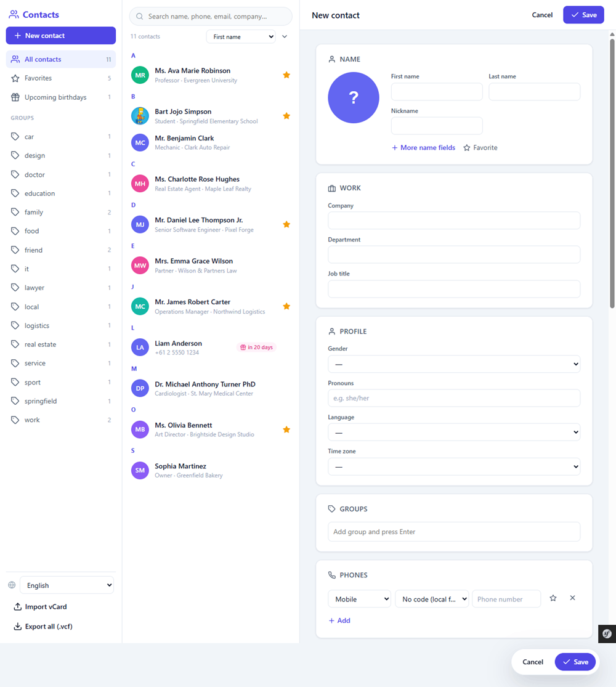
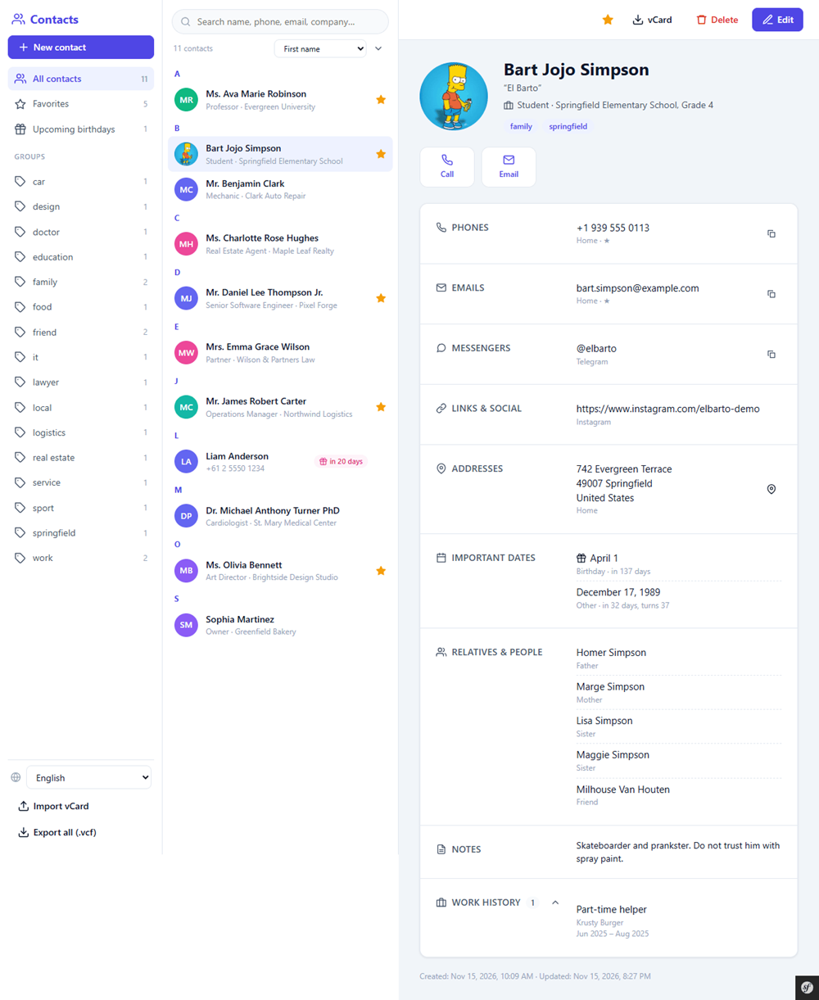

[](https://github.com/danilovl/contact-bundle/actions/workflows/phpunit.yml)
[](https://packagist.org/packages/danilovl/contact-bundle)
[](https://packagist.org/packages/danilovl/contact-bundle)
[](https://packagist.org/packages/danilovl/contact-bundle)

# ContactBundle

A Symfony bundle for a personal address book: Doctrine storage, REST API,
vCard import/export and a Vue 3 single page application.

## Requirements

- PHP 8.5 or higher
- Symfony 8.0 or higher
- TwigBundle 8.0 or higher
- Doctrine ORM 3.0 or higher and DoctrineBundle 3.2 or higher
- SecurityBundle 8.0 or higher (optional, for personal address books per user)

## Features

- Full contact card: prefix, first/middle/last name, suffix, nickname, photo, company, department, job title, birthday (with or without year), notes, favorite flag and groups (tags)
- Unlimited labelled values: phones, emails, messengers (Telegram, WhatsApp, Signal, Viber, Skype…), links and social networks, relatives and related people
- Unlimited labelled addresses and important dates (anniversary or any custom label)
- Preset labels translated in the UI plus any custom label
- Personal address book: every contact belongs to the authenticated user (`UserInterface::getUserIdentifier()`); without `symfony/security-bundle` one shared book is used
- vCard import (2.1, 3.0, 4.0 — Google, Apple, Android, Outlook exports, quoted-printable, custom labels, photos) and export (vCard 3.0) for backup; duplicates are skipped on import
- Vue 3 SPA: alphabetical list with letter groups, instant search (name, phone, email, company, groups, diacritics insensitive), favorites, upcoming birthdays, groups, detail card with call/email/messenger/map links, age and days to birthday, editor with validation, photo upload with client side resize, dark mode, mobile layout
- Live validation while typing (email, phone, links, messengers, dates), country select with flags, phone country code select with automatic country detection, native date picker, address search on an OpenStreetMap map (no API key), relatives suggested from existing contacts, work history with LinkedIn `Positions.csv` import
- 15 interface languages with a switcher (English, 中文, हिन्दी, Español, Français, العربية, Português, Русский, Deutsch, 日本語, 한국어, Türkçe, Italiano, Bahasa Indonesia, Čeština); the choice is remembered in the browser, Arabic uses right-to-left layout; dictionaries live in `assets/locales`
- Configurable access: personal books (default), one shared book, or an administrator role that manages all contacts
- Relatives are linked to real contacts (`related_contact_id`): renaming a contact updates every link, free text stays for people who are not in the address book
- vCard `UID` and `REV`: re-importing the same `.vcf` updates existing contacts instead of creating duplicates
- Photos live in a separate table, tags are real entities (rename or delete a tag for all contacts at once, fast filtering), phones and emails keep a normalized value (E.164 phones) used for search and duplicate detection
- Duplicate detection and merge, gender, pronouns, language, time zone and custom `X-` properties
- CLI commands to import and export `.vcf` files, upgrade old data, merge duplicates and move contacts between owners
- Seven list sort orders (first name, last name, company, job title, upcoming birthday, date added, date modified) in both directions
- Floating Cancel / Save bar in the editor, the form stays open after saving
- Photo upload with a crop dialog (drag to position, wheel or slider to zoom, round preview); the result is stored as a 512 px JPEG and compressed automatically to fit `photo.max_size_mb`

## Screenshots

### Create contact



### Edit contact



## Installation

```bash
composer require danilovl/contact-bundle
```

`config/bundles.php`:

```php
return [
    // ...
    Danilovl\ContactBundle\ContactBundle::class => ['all' => true],
];
```

`config/routes/danilovl_contact.yaml`:

```yaml
danilovl_contact:
    resource: '@ContactBundle/Resources/config/routing.yaml'
```

Install public assets and create the tables:

```bash
php bin/console assets:install
php bin/console doctrine:migrations:diff
php bin/console doctrine:migrations:migrate
```

The bundle registers its Doctrine mapping automatically (`Danilovl\ContactBundle\Entity`).
Tables: `danilovl_contact`, `danilovl_contact_value`, `danilovl_contact_address`, `danilovl_contact_date`,
`danilovl_contact_photo`, `danilovl_contact_tag`, `danilovl_contact_tag_link`.

### Upgrading from an older version

Generate and run a migration, then move the old data into the new structure:

```bash
php bin/console doctrine:migrations:diff
php bin/console doctrine:migrations:migrate
php bin/console danilovl:contact:upgrade
```

`danilovl:contact:upgrade` fills missing `uid`, moves photos from the `photo` column of `danilovl_contact` into
`danilovl_contact_photo`, moves tags from the legacy `tags` JSON column into `danilovl_contact_tag` and fills
`normalized_value` of phones and emails. The legacy `photo` and `tags` columns stay in the table (they are empty
after the upgrade) and can be dropped later.

Open the address book at `/danilovl/contact`.

## Security

Protect the dashboard and the API in `security.yaml`, for example:

```yaml
security:
    access_control:
        - { path: ^/danilovl/contact, roles: ROLE_USER }
```

With `symfony/security-bundle` every request works with contacts of the current user only.
Unsafe API requests (POST, PUT, PATCH, DELETE) from another origin are rejected.

## Configuration reference

```yaml
danilovl_contact:
    api:
        prefix: '/danilovl/contact/api'
    dashboard:
        path: '/danilovl/contact'
        title: 'Contacts'
    import:
        max_file_size: 20971520     # bytes
    photo:
        max_size_mb: 1.0            # maximum size of a stored photo in MB (min 0.05)
    default_owner: 'default'        # owner identifier when security-bundle is not installed
    owner_property: null            # e.g. 'id': use $user->getId() instead of getUserIdentifier() as the owner
    phone:
        default_country_code: null  # e.g. '420': local numbers (0601 234 567) are normalized as +420601234567
    access:
        mode: 'owner'               # owner: every user sees own contacts, shared: one book for everyone
        admin:
            enabled: false          # disabled by default
            role: 'ROLE_ADMIN'      # users with this role see and manage contacts of all owners
```

The owner is stored as a plain string. By default it is `getUserIdentifier()` (usually the username), so renaming a user
detaches the contacts. Set `owner_property` to a stable property (for example `id`) to avoid it, the user class must
have the matching getter (`getId()`). Move contacts after a rename with `danilovl:contact:change-owner`, remove the
contacts of a deleted user with `danilovl:contact:purge-owner`. The bundle does not depend on the user entity, so
`UserFilter` of the application does not apply to its tables, the isolation is done by `OwnerResolver`.

The administrator mode requires `symfony/security-bundle`. Contacts created by an administrator stay
owned by that administrator; the owner is shown in the contact card for administrators and in shared mode.

The photo limit is checked on the server for the stored photo (the API answers `422` with a `photo` error when it is exceeded)
and sent to the UI in `/config` as `photoMaxSize` (bytes). The editor crops the picture to a square, scales it down to
512 px and lowers the JPEG quality (and, if needed, the size) until it fits, so any original file can be selected.
A cropped 512 px photo is usually 40-120 KB, so the default of 1 MB leaves room for photos imported from vCard
files and keeps the `danilovl_contact_photo` table small. Raise it only if you import large photos.

## REST API

All endpoints are prefixed with `api.prefix`.

| Method | Path | Description |
|---|---|---|
| GET | `/config` | UI configuration (`owner`, `isAdmin`, `accessMode`, `photoMaxSize`, …) |
| GET | `/contacts` | Contact list (summary), optional `?tag=Family` filter |
| GET | `/contacts/duplicates` | Groups of contacts sharing a normalized phone or email |
| POST | `/contacts/merge` | `{"primaryId": 1, "ids": [2, 3]}` merges contacts into the primary one |
| GET | `/tags` | Tags with the number of contacts |
| PUT | `/tags/{id}` | `{"name": "New name"}` renames a tag for all contacts (merges with an existing tag of the same name) |
| DELETE | `/tags/{id}` | Removes a tag from all contacts |
| GET | `/contacts/{id}` | Full contact |
| POST | `/contacts` | Create contact |
| PUT | `/contacts/{id}` | Replace contact |
| PATCH | `/contacts/{id}/favorite` | `{"favorite": true}` |
| DELETE | `/contacts/{id}` | Delete contact |
| GET | `/contacts/{id}/photo` | Photo binary |
| GET | `/contacts/{id}/vcard` | Contact as `.vcf` |
| GET | `/export` | All contacts as `.vcf` |
| POST | `/import` | Multipart field `file` with `.vcf`, returns `{"created", "updated", "skipped", "invalid"}` |

Contact payload:

```json
{
    "prefix": "Ing.",
    "firstName": "Jan",
    "middleName": null,
    "lastName": "Novák",
    "suffix": null,
    "nickname": "Honza",
    "company": "ACME",
    "department": "R&D",
    "jobTitle": "Engineer",
    "birthday": "--05-17",
    "photo": "data:image/jpeg;base64,...",
    "notes": "Met at the conference",
    "gender": "M",
    "pronouns": "he/him",
    "language": "cs",
    "timezone": "Europe/Prague",
    "customFields": [{"key": "X-CUSTOMER-ID", "value": "42"}],
    "favorite": true,
    "tags": ["Family"],
    "phones": [{"label": "mobile", "value": "+420 777 123 456", "primary": true}],
    "emails": [{"label": "work", "value": "jan@example.com", "primary": false}],
    "messengers": [{"label": "telegram", "value": "@honza", "primary": false}],
    "urls": [{"label": "linkedin", "value": "https://linkedin.com/in/jan", "primary": false}],
    "relations": [{"label": "spouse", "value": "Eva Nováková", "primary": false, "relatedContactId": 2}],
    "addresses": [{"label": "home", "street": "Dlouhá 1", "extended": null, "city": "Praha", "region": null, "postalCode": "110 00", "country": "Czechia"}],
    "dates": [{"label": "anniversary", "date": "2015-06-20"}],
    "workHistory": [{"company": "ACME", "jobTitle": "Engineer", "startDate": "2018-03", "endDate": null}]
}
```

Dates are `YYYY-MM-DD` or `--MM-DD` (without year); work history dates are `YYYY-MM` (`endDate: null` is the current position).
`gender` is one of `M`, `F`, `O`, `N`, `U`. `customFields` keys are `X-` properties (the prefix is added automatically).
When `relatedContactId` points to a contact of the same owner, `value` is replaced by that contact's current name on every read.
Phones and emails also get a `normalized_value`: `+1 415 555 0132`, `14155550132` and `001 415 555 0132` become `+14155550132`.
Without `+` or `00` the country code is taken from `phone.default_country_code`, numbers of 11+ digits are treated as international.
Validation errors return `422` with
`{"errors": {"emails.0.value": "Invalid value."}}`.

## Commands

```bash
php bin/console danilovl:contact:import contacts.vcf --owner=username
php bin/console danilovl:contact:export backup.vcf --owner=username
php bin/console danilovl:contact:upgrade
php bin/console danilovl:contact:merge-duplicates --owner=username --dry-run
php bin/console danilovl:contact:change-owner old_username new_username
php bin/console danilovl:contact:purge-owner deleted_username
```

Exported cards contain `UID` and `REV`. Importing a card whose `UID` already exists updates the contact when `REV` is newer
than the stored `updatedAt` (cards without `REV` always update), otherwise it is skipped.

## Embedding the SPA

The dashboard template renders the SPA, the assets are included by the Twig function
`danilovl_contact_assets()`. To embed it into your own layout:

```twig
<div data-contact-app data-api-prefix="/danilovl/contact/api" data-title="Contacts" data-locale="{{ app.request.locale }}"></div>
{{ danilovl_contact_assets() }}
```

## Development

```bash
composer install
composer phpstan
composer cs-fixer-check
composer tests

docker compose build node
docker compose run --rm node npm run lint
docker compose run --rm node npm run build
```

## License

The ContactBundle is open-sourced software licensed under the [MIT license](LICENSE).
